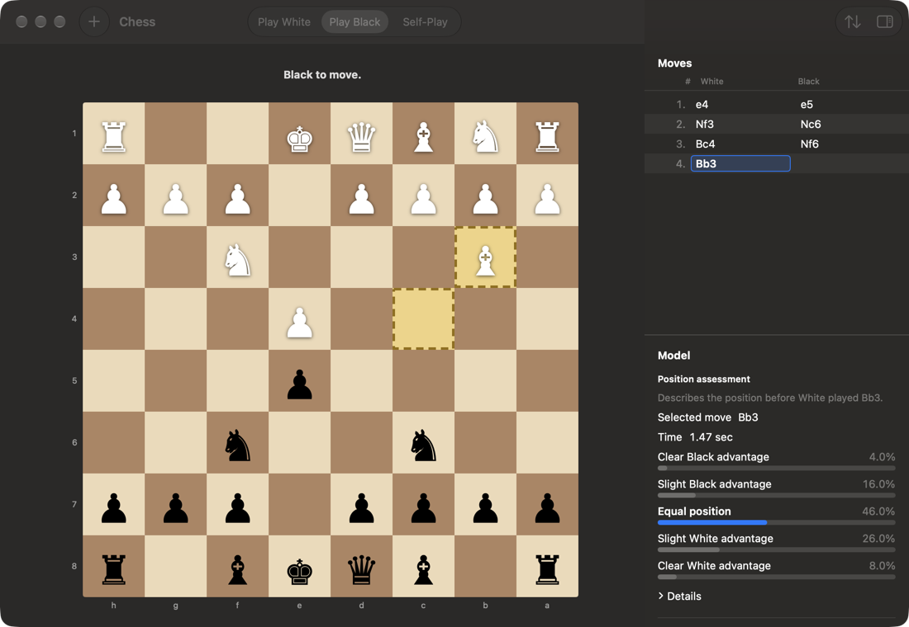
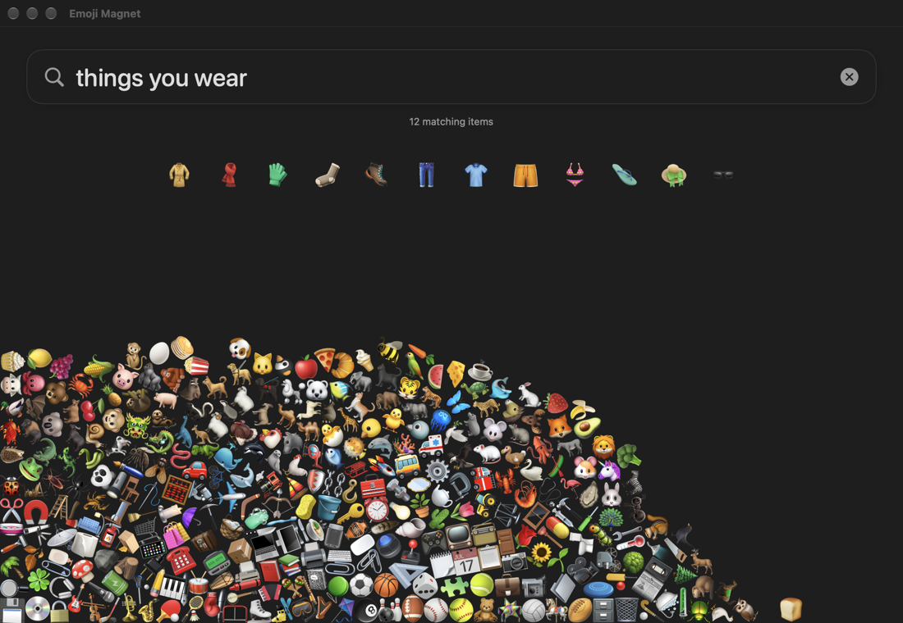

# AnyDecisionModel Examples

Examples and evaluation tools for
[AnyDecisionModel](https://github.com/mattt/AnyDecisionModel),
a Swift package for typed decisions from language models.

- [Ticket routing](#ticket-routing):
  a command-line tool that routes support tickets to a team.
- [Chess](#chess):
  a macOS app that plays chess and shows the probability of each move it considers.
- [Emoji Magnet](#emoji-magnet):
  a macOS app that pulls matching emoji out of a pile as you type.
- [Evaluations](#evaluations):
  a `decision-eval` command that measures accuracy, calibration,
  robustness, and latency.

Every example runs `mlx-community/Qwen3-4B-Instruct-2507-4bit` on your Mac
by default.
The model is a 2.3 GB download on first use.

## Requirements

- Apple silicon Mac with macOS 26+
- Xcode 27 with Swift 6.4+, selected with `xcode-select`
- Metal toolchain (`xcodebuild -downloadComponent MetalToolchain`)
- [mise](https://mise.jdx.dev/) (`brew install mise`)
- Optional: `TYPESAFE_AI_API_KEY` to use the Jev backend

The tasks call `xcrun swift`,
so they use the Xcode toolchain
even when another `swift` comes first on your `PATH`.

## Getting started

```console
mise trust
mise run setup
mise run example
```

Setup resolves Swift dependencies for the package and both apps.
It doesn't download models or datasets.

| Task | Description |
| --- | --- |
| `mise run build` | Build the command-line tools. |
| `mise run test` | Run all tests. |
| `mise run lint` | Check formatting. |
| `mise run example` | Run ticket routing. |
| `mise run example:chess` | Build and open Chess. |
| `mise run example:emoji-magnet` | Build and open Emoji Magnet. |
| `mise run eval:<command>` | Run an [evaluation](#evaluations). |

Each app also has its own `build:` and `test:` tasks,
such as `mise run test:chess`.

## Ticket routing

[`Sources/TicketRouting/main.swift`](Sources/TicketRouting/main.swift)
routes four support tickets to a team,
and sends tickets below a confidence threshold to a person:

```text
Ticket: I was charged twice this month and nobody has answered my emails in a week. Fix this NOW.
  team:    billing [billing 1.00, technical 0.00, sales 0.00], confidence 1.00
  route:   billing
  urgent:  1.000
  anger:   1.68 of 0 to 2 (Very angry)
```

Pass `--threshold` to change the threshold,
or `--jev` to use Jev instead of MLX:

```console
mise run example -- --threshold 0.7
```

## Chess



Play against the model as White or Black, or watch it play itself.
Click a piece and then a destination to move.
You can also play with the keyboard or VoiceOver.
The inspector shows the move list
and the model's assessment of the position before its last move.

[`ChessDecisionService.swift`](Examples/Chess/Chess/ChessDecisionService.swift)
opens one decision session for each model turn.
The state holds an ASCII board, the FEN, the side to move,
check status, and the move history.
The model first scores the position on five levels,
from a clear advantage for Black to a clear advantage for White.
Then it chooses a legal move in UCI notation.
When there are more than 26 legal moves,
it chooses within groups of up to 26 and then among the group winners.
The inspector shows each group separately,
because probabilities from different questions don't form one distribution.

The rule engine handles castling, en passant, and promotion.
Games end on checkmate, stalemate, threefold repetition,
the fifty-move rule, or insufficient material.
The board and piece assets came from the Chess repository at commit
`0c85c3c82182cb0cf69e5d3c15f919ddeb752464`.

Debug builds accept `-ChessFixture` with `thinking`, `failure`, `grouped`,
`promotion`, `checkmate`, or `self-play`.
Fixtures use a deterministic model and don't download weights:

```sh
open ".build/xcode-chess/Build/Products/Debug/AnyDecisionModel Chess.app" \
    --args -ChessFixture grouped
```

## Emoji Magnet



Type a phrase, such as "things you wear",
and the matching emoji rise out of a pile of 343.
Change it to "things you wear in winter",
and the items that no longer match fall back.
You can drag and toss items.
With Reduce Motion on, items move without falling or tossing.

The catalog has 124 animal emoji, up to Emoji 17.0,
plus clothing, food, plants, transport, tools, household objects,
electronics, office supplies, musical instruments, sports equipment, and toys.
It leaves out faces, people, symbols, and flags.

[`EmojiMatchService.swift`](Examples/EmojiMagnet/EmojiMagnet/EmojiMatchService.swift)
opens one decision session when typing pauses for 250 milliseconds.
It asks one yes-or-no question for each item:

```text
Statement: a dog fits the description "pet". Is this statement true?
```

Items with a probability above 0.5 rise.
MLX evaluates the questions in groups of 16,
starting with the items that matched the previous phrase.
It processes the shared state once with prefix caching,
then each group in one forward pass.
On an M4 Max, a group takes about 0.4 seconds after the model loads.
Results apply as each group finishes,
and a new phrase cancels the evaluation in progress.
Jev receives all questions in one request.

To use Jev, run `mise run example:emoji-magnet --jev`.
This passes `TYPESAFE_AI_API_KEY` to the app.

Debug builds accept `-EmojiMagnetFixture` with `matches`, `loading`, or `failure`.
The `matches` fixture answers "things you wear",
"things you wear in winter", "animals", and "anything":

```sh
open ".build/xcode-emoji-magnet/Build/Products/Debug/AnyDecisionModel Emoji Magnet.app" \
    --args -EmojiMagnetFixture matches
```

[`EmojiMagnetDebugAutomation.swift`](Examples/EmojiMagnet/EmojiMagnet/EmojiMagnetDebugAutomation.swift)
lists launch options that type phrases, toss items,
resize the window, and save snapshots.

## Evaluations

`decision-eval` runs hand-written fixtures and public datasets,
and writes JSON and CSV reports:

```console
mise run eval:sanity      # Nine cases with known answers
mise run eval:routing     # Support-ticket routing
mise run eval:robustness  # Option order, paraphrase, negation, and more
mise run eval:boolq       # BoolQ accuracy and calibration
mise run eval:agnews      # AG News accuracy and calibration
mise run eval:calibrate   # Fit a calibration and test it on held-out data
mise run eval:latency     # Model loading and batch latency
```

The routing and robustness labels haven't been reviewed by a person.
See [Evaluation methodology](docs/evaluation.md) for datasets, options, and reports,
and [Historical results](docs/historical-results.md)
for measurements from 2026-09-19.

## License

This project is available under the Apache License, Version 2.0.
See [LICENSE](LICENSE) for details.
